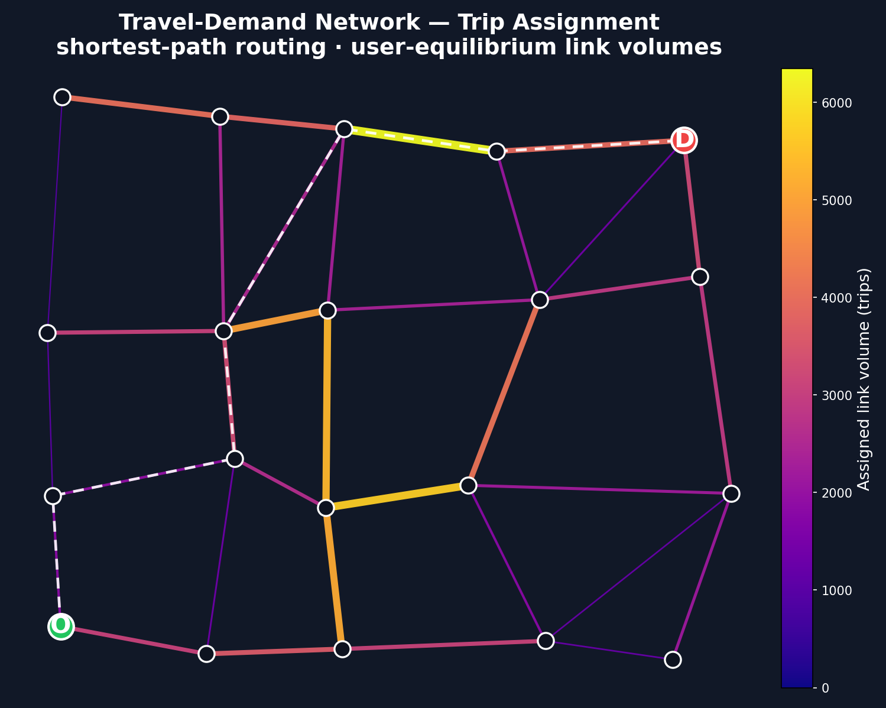
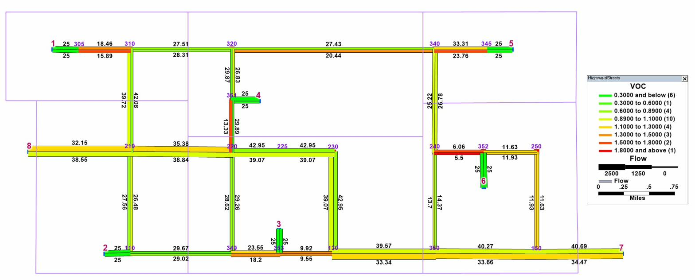

# Transportation Engineering — Graduate Coursework

Individually-authored graduate projects from my transportation-engineering studies at **UC Irvine** — the technical toolkit behind my research: network optimization, travel-demand modeling, econometrics, and energy data analysis, in Python and R.

Author: **Ghangshin Lee**. Instructor-provided templates and group work are intentionally excluded.
**Stack:** Python · R · Gurobi · pandas · tidyverse · graph algorithms · optimization · censored regression

---

## Contents

### 🕸️ [Network Algorithms & Optimization](network-algorithms-optimization/) — *CEE 228A*
- **Dijkstra** and **Floyd–Warshall** shortest-path implementations from scratch
- **Linear-programming** formulations of the transportation and transshipment problems, solved with **Gurobi**

### 🚦 [Travel-Demand Modeling](travel-demand-modeling/) — *CEE 220A*
A four-step travel-demand workflow on real **PeMS** detector data — loading, cleaning, and structuring traffic-flow data for demand analysis.

### 📈 [Transportation Econometrics](transportation-econometrics/) — *CEE 224A*
Discrete and limited-dependent-variable modeling in **R**:
- **Tobit** (censored regression)
- Linear regression of **MTA subway ridership vs. gasoline prices**

### ⚡ [Energy Data Analysis](energy-data-analysis/) — *CEE 298*
U.S. EIA **Residential Energy Consumption Survey (RECS 2020)** in R — survey wrangling, descriptive analysis, visualization.

---

## Selected figures

| Travel-demand network assignment | Network assignment (TransCAD) |
|---|---|
|  |  |

## Skills demonstrated

`Python` · `R` · graph algorithms · linear programming (`Gurobi`) · travel-demand modeling · censored / limited-dependent-variable regression · survey-data analysis · `pandas` · `tidyverse` · data visualization

## Notes on data

Coursework artifacts. Most inputs (PeMS, MTA, RECS, network `.tntp` files) are public but not committed; file paths are genericized to `./data`. Notebooks keep their executed outputs so the analysis is readable directly on GitHub.

## License

[MIT License](LICENSE).
